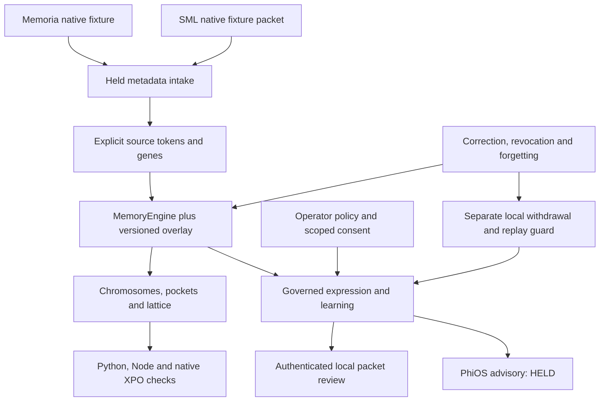

# Living Memory v1 — persistent synthetic proof loop

Status: implemented and executed locally as a bounded fixture candidate.
Production integration remains **HELD**. Controlling acceptance and threat
model: [LIVING_MEMORY_ACCEPTANCE_V1.md](LIVING_MEMORY_ACCEPTANCE_V1.md).
R1 repair/audit: [LIVING_MEMORY_AUDIT_R1.md](LIVING_MEMORY_AUDIT_R1.md).
Original June specifications and all R0 APIs remain intact.

## Architecture and ownership



| Component | Owner / reused capability | Boundary |
|---|---|---|
| Persistent genes and lifecycle | PhiMemory9 MemoryEngine, nested transactions, native IDs, fingerprints and lineage | New fixture overlay only; no existing store migration |
| Metadata source export | Memoria native init_db/store_memory/set_permission plus new local exporter | Exact app read permission, no payload SQL selection; real API blocked |
| SML projection | Native MemoryPacket creation/to_dict plus existing R0.5 held projection | Native lifecycle, collaboration and unresolved relationships preserved; full store exporter remains pending |
| Geometry | PhiMemory9 bounded set-like selectors and shared references | Reversible hierarchy; no claim of novel mathematics or geometry superiority |
| Canonical exchange | Independent Node checker; native XiPhiOmega XPO-002 Python and Node codecs | XPO transports a reference commitment; it does not authenticate the full catalog or authorize use |
| Consent | Explicit local fixture identities, purpose/app/project/context/operation, privacy, lifetime and policy revision | Local key possession only; no real identity certification or human exception UI |
| Local packet admission | PhageLedger software-only v1 HMAC, current governance recheck, evidence-event binding | In-process metadata endpoint; no network, arbitrary code, action or replication |
| Retention enforcement | Transitive overlay holds and content scrubbing; separately attached SQLite guard | Logical fixture deletion only; external copies and physical media unknown |
| Learning | Governed observation store, R0.8 enumerator and native PhiGenesis 007 infer | Finite authored affine family; no general intelligence claim |
| Ecosystem review | New PhiOS advisory module | Always HELD; no GovernedMemoryService/Reality Ledger/Verification Spine writes |

The inspected Altermath RM-369 codec, NestedBubbleGear lineage witness model
and NBGPocketMesh policy witness reinforce separation of representation,
lineage and external trust. No native geometric runtime dependency was added:
simple nesting demonstrates shared membership and stable identity directly.
PhiProof and PhiDiscovery supply examples of narrow evidence/claim boundaries;
their scientific certification is not inherited by this candidate. PhiCleanroom
currently verifies a different pinned reference behavior; it was not falsely
reused as a memory certificate. Agentora and PhiBuddy remain potential explicit
operator consumers, without runtime changes. AxiomForge was NOT_FOUND through
connected GitHub; its identity or access remains unresolved.

## R1–R9 readiness matrix

“Demonstrated” below means local synthetic execution, not production completion.

| Rung | Demonstrated in this candidate | Remaining / blocked |
|---|---|---|
| R1 | Exact nine merged heads and CI checked; 124 baseline tests; two reproduced ancestry-leak counterexamples repaired; separate inverse oracle across 930 maps | External independent security/requirements audit |
| R2 | Versioned native SQLite overlay, typed records, transactional creation, shared token/chromosome memberships, reconstruction and explicit fixture v1→v2 migration | Personal-store migrations and general migration history not authorized |
| R3 | Native Memoria disposable DB export with read permission; native SML packet metadata projected and held | Real Memoria API/key/vector/delete fixes; SML store-level exporter; authenticated source principals |
| R4 | Token→gene→chromosome→pocket→lattice, preserved native identity/scope, order normalization, nested/flat round trips, three frozen canonical vectors, separate Node checker, native XPO-002 byte agreement | Native geometric engine coupling has no demonstrated need; no semantic-equivalence proof |
| R5 | Current explicit scoped consent, issue/withdraw, expiry, privacy, activation/suppression, operation separation, monotonic policy revisions, persistent evidence-bound events | External identity/key custody, human-reviewed exceptions, real high-impact evidence validity |
| R6 | Bounded HMAC local fixture packets, authenticated destination, receipt binding, validity window, durable replay/idempotency, key revocation and restore refusal | Production/asymmetric key lifecycle; cross-process/network interoperability |
| R7 | Distinct correction/supersession/retirement/revocation/forgetting; transitive holds, local index/cache/export scrubbing, interruption rollback, main-only backup restoration guard | External source/recipient/backup copies, secure media erasure, rollback of both guard and store |
| R8 | Persistent governed observations; recomputation after withdrawal, cold/simple baselines, native PhiGenesis arithmetic agreement, bounded negative transfer and restart checks | Native experiential-runtime integration, unseen data and externally blind evaluation |
| R9 | Nine-step native fixture proof loop; actual PhiOS advisory returns HELD after every declared check passes | Native authority/retention mapping, operator interfaces and production readiness |

No rung is declared fully production complete.

## Persistence and trust contract

`LivingStore.create` accepts only two new regular fixture files. `open` requires
matching schema/store/owner markers and a registered external 32-byte operator
key. No ordinary existing memory database is upgraded. v1→v2 adds explicit
retention obligations and governed observations; unsupported versions refuse.
MemoryToken native identity, MemoryGene identity, MemoryEngine ID, source
instance, source revision and the geometry namespace are separate fields.
Tokens may support multiple genes; chromosomes share references without copying
the underlying meaning. Corrections use new identities and repair lineage.

Consent binds exact principal, gene revision, project, application, purpose,
context tags, optional transfer destination, operation and time window to the
current policy commitment. A retrievable gene is not automatically expressible;
an expression grant does not grant transfer or learning; no operation grants
execution. Unknown source policy stays null in native staging. Explicitly
authored synthetic meaning and local grants are a separate experiment lane.

The fixture operator and host process are trusted. Public fixture APIs are not
a sandbox against a hostile process with direct database or object access.
Keys are supplied externally and never stored in the memory DB. Symmetric HMAC
authenticates key possession, not legal identity or an asymmetric signature.
Principal key rebinding/reactivation is refused; revocation is durable. Operator
trust-root replacement and production custody remain unsupported.

The guard is a second attached SQLite database, using rollback journals so a
local transaction can commit or roll back both files. It keeps keyed opaque
withdrawal/replay identifiers rather than raw payloads. It prevents resurrection
when **only the memory file** is restored. It cannot prevent an administrator
from restoring/deleting both files, stealing keys, editing trust state or
bypassing this API. A remote/TPM or separately administered witness requires a
future explicit design. Never silently substitute it with a local hash chain.

Fixture forgetting scrubs current SQL content/fingerprints/source refs, source
token metadata, observation labels, memberships, affected lineage/events and
local tracked copies. Unrelated ID prefixes do not match deletion selectors.
Deleted identities remain opaque suppression anchors. Original hard-copy
backups and untracked/native recipients are **not erased**; surviving external
coverage is unknown. Guard reconciliation re-scrubs restored content and
regenerates unknown obligations. SQLite/OS/physical remnants are unverified.

## Geometry and wire contract

`genomememory-geometry/v1` preserves complete scoped genes, source-token/native
identity bindings, chromosomes, pockets and lattice namespace. Nesting changes
selectors, not native identity. Every chromosome is addressed; unknown parents,
cycles, scope leakage and missing source bindings fail. Aggregated member counts
are lossy: equal counts do not imply the same memberships or information.

The canonical dialect is intentionally restricted: printable ASCII strings,
safe integers, booleans, null, bounded arrays and objects. No floats, non-ASCII,
ambiguous JSON number spellings, duplicate keys or unbounded recursion. It is
not a general JSON/JCS implementation. Three frozen literals/digests and a
separate Node implementation check spelling and nesting. Native XPO-002 encodes
a catalog commitment plus identities, keeping its original 1,024-byte atom
limit. Python and Node return identical native capsule bytes. Neither an equal
hash nor an authenticated packet proves semantic truth or permission.

## Executed evidence and measured limitations

Detailed receipts are in `docs/living-memory/v1/`; exact source baselines are in
`docs/living-memory/source-manifest-v1.json`. The source-specific native fixture
run covers Memoria, SML MemoryPacket, XiPhiOmega, PhiGenesis and PhiOS. The SML
materialized source matched its recorded native Git blob exactly; private source
was not copied into this repository. Public CI deliberately does not request
private SML access; its missing source check is explicitly recorded.

- Full final local suite: **161/161** test methods (124 original + 5 R1 + 32 new).
- Original integration harness: **56/56**, seven authored scenarios.
- Independent implementation arithmetic: **930/930** designed rules and **1,860**
  held-out predictions; same author, no external audit.
- Canonical/nesting Node demonstration: **18 checks**, including three frozen
  vectors, seven invalid values, four invalid wire spellings and a round trip.
- Native proof loop: **9/9** checks; production ready false; actual PhiOS HELD.
- Memoria exporter: **4/4** tests; PhiOS advisory: **6/6** focused local tests.

Learning benchmark: nine authored affine relations, three repeated contexts,
**54/54** predictions for memory, cold enumeration and simple modular inverse.
Only **18 distinct** held-out relation/input pairs exist; repetition is not
independent evidence. Source teacher-response budgets are 45 train/audit
acquisitions for memory versus 135 per cold method, including initial memory
formation. These are explicit synthetic accounting units, not measured external
source access. Memory loads 189 observation rows, makes 189 governance checks
and issues 1,728 traced SQL statements. Both full validation and admitted fitting
are charged: upper bounds 150,660 versus 75,330 hypothesis-row comparisons.
Audit and held-out comparisons are separately charged for both passes. The
simple baseline needs only 27 modular inversions plus consistency/audit checks.

The recorded native run used about 0.117 seconds for governed memory, 0.012 for
cold enumeration and 0.000148 for the inverse baseline, plus about 0.951 seconds
of memory setup and 1,880,064 bytes across nine SQLite/guard pairs. Timing is
machine/run-specific, with trace callback overhead and no hardware normalization.
Baseline source storage is not measured. Memory is substantially more expensive
computationally here; the result does **not** establish overall superiority.

Constructed offset drift causes **9/9** governed abstentions; naive rule reuse is
wrong on **18/18** corresponding predictions by construction. Native PhiGenesis
007 agrees on **27/27** rule inferences using 81 validation observations.

Preserved failures: two pre-repair R1 assertion failures. During implementation,
cost accounting was corrected to charge both enumerator passes and separate
audit/test/setup/native verification work; the final benchmark report supersedes
the initial cost-label draft. No external benchmark or certificate is claimed.

## Reproduce locally

Python 3.10+ and Node 20+ for core tests; Python 3.11+ for PhiOS. This session used
Python 3.12.14, Node 24.22.3 and SQLite 3.53.1. Existing Memoria cryptography is
needed only for its native schema initializer. No new core dependency is added.

```sh
git clone --branch research/living-memory-persistent-v1 https://github.com/MichaelWave369/PhiMemory9.git
cd PhiMemory9
python -m pip install -e .
python -m unittest discover -s tests -v
node scripts/living_conformance.mjs
python -m phimemory9.genomememory_integration report
python -m phimemory9.living_demo --output ./disposable-proof-loop
```

The last command is self-contained and explicitly records native export as
missing; all other implemented checks execute. Use a **new output directory**
each time. Existing outputs and stores are never overwritten by the demo.

For native components, clone adjacent checkouts and pin the candidate sources:

```sh
git clone https://github.com/MichaelWave369/Memoria.git ../Memoria
git -C ../Memoria fetch origin research/genomememory-native-export-v1
git -C ../Memoria checkout 94083ad7c710097658ba96b7a1376e5e044d2382
git clone https://github.com/MichaelWave369/PhiGenesis.git ../PhiGenesis
git -C ../PhiGenesis checkout bfedf68cbc7649adb13da97a78a61e68bbf3d970
git clone https://github.com/MichaelWave369/XiPhiOmega.git ../XiPhiOmega
git -C ../XiPhiOmega checkout 18c000897beedfb5a9759befcfd4e2330f61e227
git clone https://github.com/MichaelWave369/PhiOS.git ../PhiOS
git -C ../PhiOS fetch origin research/genomememory-advisory-v1
git -C ../PhiOS checkout 0eb88a0ab58d51b54962457cdb510f603827bc88
python -m pip install 'cryptography>=43'
python -m phimemory9.living_demo --output ./disposable-native-loop \
  --memoria-source ../Memoria --xi-source ../XiPhiOmega \
  --genesis-source ../PhiGenesis --phios-source ../PhiOS --require-native
```

Optional SML owner-access checkout at 43f7513c46529167d842a7c195029b03574dc393:
add `--sml-packets ../sovereign-memory-lattice/sml/memory/packets.py` to the native
command. This executes only a new MemoryPacket fixture and excludes its payload.
It never opens a personal SML store. Advisory CLI:

```sh
PYTHONPATH=../PhiOS python -m phios.genomememory_advisory ./disposable-native-loop/advisory.json
```

Expected exit **3** means HELD. It is not a test failure or execution grant.

## Next sequence

1. External review of R1 counterexamples and the versioned fixture contract.
2. Coordinate authenticated Memoria reads/writes, encryption keys, vector
   privacy and deletion before any real-memory bridge.
3. Implement source-owned SML store export and external identity/key custody;
   then test cross-process transport and rollback witnesses separately.
4. Conduct externally blind, unseen-family learning evaluation with matched
   acquisition/validation/storage/compute budgets and preserved failures.
5. Only after those gates, design an explicit PhiOS governed-memory adapter and
   operator interface. No personal migration, deployment or PR merge is implied.
